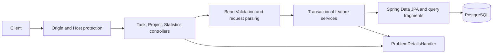

# TaskFlow backend

The backend is the local, single-user HTTP API for TaskFlow. The frozen shared
contract in [`../../docs/api.md`](../../docs/api.md) is authoritative; this
document describes the implementation and operations without changing that
contract.

## Architecture

The application is organized by feature and layer:

- `com.taskflow.backend.task.api`: task REST controller and request/response
  DTOs, Bean Validation constraints, and OpenAPI operation documentation.
- `com.taskflow.backend.task.service`: transactional task use cases, timezone
  boundary calculation, project-assignment locking, and ETag preconditions.
- `com.taskflow.backend.task.persistence`: JPA task entity, version-guarded
  writes, database-side filter/sort/page/search queries, and completion counts.
- `com.taskflow.backend.project`: project REST API, transactional CRUD service,
  entity, and row-locking/aggregate repository.
- `com.taskflow.backend.statistics`: statistics response schemas, API endpoint,
  and timezone-aware service that combines database aggregates.
- `com.taskflow.backend.shared`: Unicode utilities, validation annotation,
  local-origin guard, API exceptions, and RFC 9457 error mapping.
- `com.taskflow.backend.config`: OpenAPI metadata, strict JSON handling, and
  injectable UTC server clock.

Request flow:



The server has no login or multi-user identity. It is intended for local
single-user use only; the database port is bound to loopback by the root
Compose configuration, and the HTTP server binds to `127.0.0.1` by default.
The request interceptor also rejects nonlocal `Host` values, including on
read requests.

## Technology

- Java 21.
- Spring Boot 4.1.2, Spring MVC, Jakarta Bean Validation, Spring Data JPA.
- PostgreSQL 17 in the repository Compose configuration.
- Flyway versioned migrations; Hibernate schema mode is `validate`.
- springdoc-openapi 3.2.0 and Swagger UI.
- Maven Wrapper using Maven 3.9.12.
- JUnit 5-compatible JUnit Jupiter, Mockito, Spring Test, and JaCoCo 0.8.14.

## Configuration

The backend reads configuration from the process environment. Local defaults
are for development only:

| Variable | Default | Purpose |
|---|---|---|
| `TASKFLOW_DB_URL` | `jdbc:postgresql://127.0.0.1:5432/taskflow?connectTimeout=3&socketTimeout=10&tcpKeepAlive=true` | JDBC URL and client timeouts |
| `TASKFLOW_DB_USERNAME` | `taskflow` | PostgreSQL role |
| `TASKFLOW_DB_PASSWORD` | empty | PostgreSQL password; set it locally and never commit it |
| `TASKFLOW_ALLOWED_ORIGINS` | `http://localhost:5173,http://127.0.0.1:5173` | Comma-separated permitted local browser origins |
| `PORT` | `8080` | HTTP server port |

`server.address` is fixed to `127.0.0.1` in the default application
configuration to keep this unauthenticated service local-only.
Set `POSTGRES_PASSWORD` in the root `.env` for Compose and provide the matching
`TASKFLOW_DB_PASSWORD` to the backend process. `.env.example` contains
placeholders, not credentials. The connection pool is capped at ten
connections with bounded connect/validation waits. No permissive CORS policy
is enabled. Browser-origin checks apply to state-changing requests; requests
without an `Origin` header remain usable by local command-line clients.

## Build, run, and test

From `backend\` in Windows PowerShell:

```powershell
.\mvnw.cmd clean verify
.\run.bat
```

Start PostgreSQL first using `docker compose up -d` from the repository root.
The launcher is generated for normal user operation; it is not used by the
automated verification. `clean verify` runs compilation, unit tests, the
random-port HTTP integration test, and the JaCoCo bundle line-coverage gate.
The test profile excludes datasource, Hibernate/JPA, Flyway, and JPA repository
auto-configuration and replaces the repository with a Mockito mock. No H2,
Docker, or external database is used by tests.

The build requires at least 80% bundle line coverage. JaCoCo excludes only the
generated/main `TaskFlowApplication` entry-point class; no feature or
application logic is excluded.

## API

- Canonical contract: [`../../docs/api.md`](../../docs/api.md).
- Swagger UI: `http://localhost:8080/swagger-ui.html`.
- OpenAPI JSON is configured at `/v3/api-docs`; it is not polled or fetched by
  build or test checks.
- Postman v2.1 collection:
  [`../postman/taskflow.postman_collection.json`](../postman/taskflow.postman_collection.json).
  It covers all 12 task/project/statistics method-path pairs, representative
  errors, and chained ETags. Mutation scripts guard collection-owned task and
  project IDs.

The API supports paginated task search and filtering, task reads/create/full
replacement/status changes/delete, project CRUD, and aggregate statistics.
Task-only title/description clients remain compatible: omitted date/project
default to null, priority defaults to medium, and status defaults to active.
Search is a case-insensitive literal substring match; `%`, `_`, and backslash
are escaped before PostgreSQL `ILIKE`. Blank search is treated as no search.
Filtering, ordering, counts, and pagination run in PostgreSQL. All sort keys
use stable `created_at DESC, id DESC` tie-breakers; due sorts place null dates
last.

| Method | Path | Purpose |
|---|---|---|
| `GET` | `/api/tasks` | Search/filter/sort and page task results on the server. |
| `GET` | `/api/tasks/{id}` | Read a task with its strong ETag. |
| `POST` | `/api/tasks` | Create a task and return Location/ETag. |
| `PUT` | `/api/tasks/{id}` | Replace editable fields with required If-Match. |
| `PATCH` | `/api/tasks/{id}/status` | Complete/reopen without replacing other fields. |
| `DELETE` | `/api/tasks/{id}` | Delete with required If-Match. |
| `GET` | `/api/projects` | List all projects, including empty projects. |
| `GET` | `/api/projects/{id}` | Read a project and strong ETag. |
| `POST` | `/api/projects` | Create a case-insensitively unique project. |
| `PUT` | `/api/projects/{id}` | Rename with required If-Match. |
| `DELETE` | `/api/projects/{id}` | Unassign/version affected tasks, then delete with If-Match. |
| `GET` | `/api/statistics` | Return timezone-aware daily, weekly, and per-project totals. |

## Data model and migrations

`V1__create_tasks.sql` creates the `tasks` table with UUID primary key,
nonblank title, non-null description, integer version, and internal creation
timestamp. Check constraints reject blank titles and negative versions.
Migration indexes include the stable list-order index and GIN trigram indexes
on title and description. The migration enables PostgreSQL `pg_trgm`.

`V2__add_task_organization_and_statistics.sql` creates versioned projects and
adds task due date, priority, optional project UUID, status, and completion
timestamp. Existing V1 rows are preserved and receive the migration defaults
(active, medium, null deadline/project/completion time) without changing their
IDs, text, versions, or creation ordering. Constraints validate supported
status/priority values and completion timestamp consistency. A unique
case-insensitive project-name index and task date/project indexes support the
query contract. Project deletion explicitly unassigns tasks and increments
their versions before removing the project; the FK is restrictive as a final
guard against silent task mutation.

Create never accepts a user-provided ID or version. Update and delete accept
the resource ID in the path and the expected version in `If-Match`. Mutations
use guarded PostgreSQL statements that change fields and increment `version`
only when both ID and expected version match. Status writes increment version
even when status is unchanged; unchanged completed tasks retain their
completion instant, reopening clears it, and completing again records the
injectable server clock. A zero-row mutation is `412`; an absent resource is
`404`. Project row locks serialize assignment/rename/deletion, and task
conditional updates prevent deletion/unassignment from overwriting concurrent
task writes.

## Validation and errors

- Title is trimmed using ECMAScript-compatible whitespace rules, must be
  nonblank, and is limited to 200 Unicode code points.
- Description defaults from missing/null to `""`, preserves whitespace, and
  is limited to 10,000 Unicode code points.
- Due dates are strict `YYYY-MM-DD` calendar dates (years 0001–9999), parsed
  without timezone conversion. Priority is `low|medium|high`; status is
  `active|completed`. Omitted values default for title/description-only
  clients; explicit null priority/status values are rejected. Project UUID
  references must exist or return a `400` field error.
- Project names use the same trimming rules, require 1–100 Unicode code
  points, and are unique without regard to case. Duplicate names return 409.
- Page defaults to `0`, size defaults to `20` and must be 1–100, and `q` is
  trimmed and limited to 200 code points. Invalid values are rejected, never
  clamped. List and search use native `LIMIT`/`OFFSET` queries with 64-bit
  offsets so every valid nonnegative integer page index can return its empty
  page without overflowing JPA's integer pagination API.
- `If-Match` must be a quoted non-negative decimal integer. Missing headers
  produce `428`; malformed headers produce `400`; stale versions produce
  `412`.
- Task list filters and sort names are explicit allowlists. Relative date
  filters use the server clock in the requested IANA `timeZone` (UTC by
  default); invalid zones are rejected. Due dates remain date-only values.
- Statistics count currently completed tasks using their latest completion
  timestamp, include zeroes for all seven local calendar dates ending today,
  and calculate per-project rates with one decimal place. DST days are
  bounded by timezone-aware local midnights. Empty projects appear with a
  zero rate; unassigned tasks count globally but not in project rates.
- Errors use `application/problem+json` and RFC 9457 Problem Details. Field
  validation may include a `fieldErrors` map. Unexpected failures are logged
  server-side and returned without stack traces, SQL, connection details, or
  credentials.
- Database access failures map to a sanitized `503`.

## Logging and local-origin protections

Application logs use Spring/SLF4J logging. Database and unexpected
server-side failures are logged by exception type without logging potentially
sensitive exception messages; the HTTP response remains sanitized. Do not
enable SQL parameter logging in a local deployment that may contain private
task text.

No permissive CORS configuration is present. Mutating browser requests are
accepted only from configured local development origins or the request's own
origin. API requests also require a local `Host` value; a nonlocal host cannot
be made valid by sending a matching `Origin`. Requests without an `Origin`
header are supported for local tools.
Do not bind PostgreSQL or expose the unauthenticated API to a network.

## Verification and limitations

The mocked-database Spring integration test starts the full MVC application
on a random port and sends actual HTTP requests through validation,
serialization, origin checks, controllers, services, and error mapping. It
does not validate Hibernate mappings against PostgreSQL, execute Flyway, prove
database persistence across process/container restart, or exercise transaction
isolation against concurrent database sessions.

Run the no-server Postman checks from `backend\postman`:

```powershell
python verify_collection.py
node test_collection_scripts.js
```

The JaCoCo gate measures BUNDLE line coverage at 0.80. Its only exclusion is
`com/taskflow/backend/TaskFlowApplication.class` (the application entry point);
no service or feature code is excluded. The build does not include a
SonarJava Cognitive Complexity analyzer, so per-method scores are reported as
unverified unless a compatible analyzer is run separately.

Separate manual checks against an isolated, password-protected PostgreSQL
17.11 instance on Windows exercised Flyway migration, schema validation,
literal and Unicode search, concurrent versioned writes, database-outage
handling, restart persistence, and backup with an isolated restore. A real
browser also exercised the frontend against this backend and database. These
checks do not replace the mocked-database automated tests.

Subsequent manual checks with Docker Desktop and PostgreSQL 17 Alpine verified
Compose startup, named-volume persistence across container recreation,
case-insensitive Unicode and literal wildcard searches, a real browser
workflow, and backup with an isolated restore. A separate backend also read
the restored database. There is no automated full-stack test using the real
frontend, backend, and database.
See [`../../docs/operations.md`](../../docs/operations.md) and
[`../../docs/performance/README.md`](../../docs/performance/README.md) for
operational checks and performance results.

The repository's Javadoc requirement is followed for public production
methods. Cognitive Complexity is not measured by the Maven build; report it as
unverified unless a compatible analyzer is run separately.
