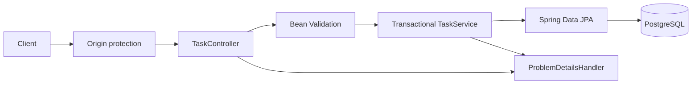

# TaskFlow backend

The backend is the local, single-user HTTP API for TaskFlow. The frozen shared
contract in [`../../docs/api.md`](../../docs/api.md) is authoritative; this
document describes the implementation and operations without changing that
contract.

## Architecture

The application is organized by feature and layer:

- `com.taskflow.backend.task.api`: REST controller and JSON records, Bean
  Validation constraints, and OpenAPI operation documentation.
- `com.taskflow.backend.task.service`: transactional use cases, request
  normalization, precondition parsing, and response mapping.
- `com.taskflow.backend.task.persistence`: JPA entity, Spring Data repository,
  guarded mutation queries, and PostgreSQL literal-search fragment.
- `com.taskflow.backend.shared`: Unicode utilities, validation annotation,
  local-origin guard, API exceptions, and RFC 9457 error mapping.
- `com.taskflow.backend.config`: OpenAPI document metadata.

Request flow:



The server has no login or multi-user identity. It is intended for local
single-user use only; the database port is bound to loopback by the root
Compose configuration, and the HTTP server binds to `127.0.0.1` by default.
The request interceptor also rejects nonlocal `Host` values, including on
read requests.

## Technology

- Java 21.
- Spring Boot 4.1.2, Spring MVC, Jakarta Bean Validation, Spring Data JPA.
- PostgreSQL 17 in the repository Compose configuration.
- Flyway versioned migrations; Hibernate schema mode is `validate`.
- springdoc-openapi 3.2.0 and Swagger UI.
- Maven Wrapper using Maven 3.9.12.
- JUnit 5-compatible JUnit Jupiter, Mockito, Spring Test, and JaCoCo 0.8.14.

## Configuration

The backend reads configuration from the process environment. Local defaults
are for development only:

| Variable | Default | Purpose |
|---|---|---|
| `TASKFLOW_DB_URL` | `jdbc:postgresql://127.0.0.1:5432/taskflow?connectTimeout=3&socketTimeout=10&tcpKeepAlive=true` | JDBC URL and client timeouts |
| `TASKFLOW_DB_USERNAME` | `taskflow` | PostgreSQL role |
| `TASKFLOW_DB_PASSWORD` | empty | PostgreSQL password; set it locally and never commit it |
| `TASKFLOW_ALLOWED_ORIGINS` | `http://localhost:5173,http://127.0.0.1:5173` | Comma-separated permitted local browser origins |
| `PORT` | `8080` | HTTP server port |

`server.address` is fixed to `127.0.0.1` in the default application
configuration to keep this unauthenticated service local-only.
Set `POSTGRES_PASSWORD` in the root `.env` for Compose and provide the matching
`TASKFLOW_DB_PASSWORD` to the backend process. `.env.example` contains
placeholders, not credentials. The connection pool is capped at ten
connections with bounded connect/validation waits. No permissive CORS policy
is enabled. Browser-origin checks apply to state-changing requests; requests
without an `Origin` header remain usable by local command-line clients.

## Build, run, and test

From `backend\` in Windows PowerShell:

```powershell
.\mvnw.cmd clean verify
.\run.bat
```

Start PostgreSQL first using `docker compose up -d` from the repository root.
The launcher is generated for normal user operation; it is not used by the
automated verification. `clean verify` runs compilation, unit tests, the
random-port HTTP integration test, and the JaCoCo bundle line-coverage gate.
The test profile excludes datasource, Hibernate/JPA, Flyway, and JPA repository
auto-configuration and replaces the repository with a Mockito mock. No H2,
Docker, or external database is used by tests.

The build requires at least 80% bundle line coverage. JaCoCo excludes only the
generated/main `TaskFlowApplication` entry-point class; no feature or
application logic is excluded.

## API

- Canonical contract: [`../../docs/api.md`](../../docs/api.md).
- Swagger UI: `http://localhost:8080/swagger-ui.html`.
- OpenAPI JSON is configured at `/v3/api-docs`; it is not polled or fetched by
  build or test checks.
- Postman v2.1 collection:
  [`../postman/taskflow.postman_collection.json`](../postman/taskflow.postman_collection.json).
  It covers all five CRUD methods and representative errors; write requests are
  guarded so the collection only mutates a task it created itself.

The API supports paginated list/search, read, create, full replacement of
title/description, and permanent delete. Search is case-insensitive literal
substring matching; `%`, `_`, and backslash are escaped before PostgreSQL
`ILIKE`. Blank search is treated as no search. Results are ordered by
`created_at DESC, id DESC`.

## Data model and migrations

`V1__create_tasks.sql` creates the `tasks` table with UUID primary key,
nonblank title, non-null description, integer version, and internal creation
timestamp. Check constraints reject blank titles and negative versions.
Migration indexes include the stable list-order index and GIN trigram indexes
on title and description. The migration enables PostgreSQL `pg_trgm`.

Create never accepts a user-provided ID or version. Update and delete accept
the task ID in the path and the expected version in `If-Match`. Updates use a
guarded PostgreSQL statement that changes the editable fields and increments
`version` only when both the task ID and expected version match. Deletes use
the same ID/version predicate. This makes version check and mutation atomic,
including no-op replacements. A zero-row mutation is reported as `412`; an
absent task discovered before mutation is `404`.

## Validation and errors

- Title is trimmed using ECMAScript-compatible whitespace rules, must be
  nonblank, and is limited to 200 Unicode code points.
- Description defaults from missing/null to `""`, preserves whitespace, and
  is limited to 10,000 Unicode code points.
- Page defaults to `0`, size defaults to `20` and must be 1–100, and `q` is
  trimmed and limited to 200 code points. Invalid values are rejected, never
  clamped. List and search use native `LIMIT`/`OFFSET` queries with 64-bit
  offsets so every valid nonnegative integer page index can return its empty
  page without overflowing JPA's integer pagination API.
- `If-Match` must be a quoted non-negative decimal integer. Missing headers
  produce `428`; malformed headers produce `400`; stale versions produce
  `412`.
- Errors use `application/problem+json` and RFC 9457 Problem Details. Field
  validation may include a `fieldErrors` map. Unexpected failures are logged
  server-side and returned without stack traces, SQL, connection details, or
  credentials.
- Database access failures map to a sanitized `503`.

## Logging and local-origin protections

Application logs use Spring/SLF4J logging. Database and unexpected
server-side failures are logged by exception type without logging potentially
sensitive exception messages; the HTTP response remains sanitized. Do not
enable SQL parameter logging in a local deployment that may contain private
task text.

No permissive CORS configuration is present. Mutating browser requests are
accepted only from configured local development origins or the request's own
origin. API requests also require a local `Host` value; a nonlocal host cannot
be made valid by sending a matching `Origin`. Requests without an `Origin`
header are supported for local tools.
Do not bind PostgreSQL or expose the unauthenticated API to a network.

## Verification and limitations

The mocked-database Spring integration test starts the full MVC application
on a random port and sends actual HTTP requests through validation,
serialization, origin checks, controllers, services, and error mapping. It
does not validate Hibernate mappings against PostgreSQL, execute Flyway, prove
database persistence across process/container restart, or exercise transaction
isolation against concurrent database sessions.

Separate manual checks against an isolated, password-protected PostgreSQL
17.11 instance on Windows exercised Flyway migration, schema validation,
literal and Unicode search, concurrent versioned writes, database-outage
handling, restart persistence, and backup with an isolated restore. A real
browser also exercised the frontend against this backend and database. These
checks do not replace the mocked-database automated tests.

Subsequent manual checks with Docker Desktop and PostgreSQL 17 Alpine verified
Compose startup, named-volume persistence across container recreation,
case-insensitive Unicode and literal wildcard searches, a real browser
workflow, and backup with an isolated restore. A separate backend also read
the restored database. There is no automated full-stack test using the real
frontend, backend, and database.
See [`../../docs/operations.md`](../../docs/operations.md) and
[`../../docs/performance/README.md`](../../docs/performance/README.md) for
operational checks and performance results.

The repository's Javadoc requirement is followed for public production
methods. Cognitive Complexity is not measured by the Maven build; report it as
unverified unless a compatible analyzer is run separately.
